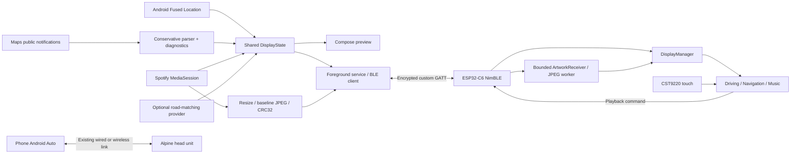

# Car Companion · 986

A native Android companion and standalone ESP32-C6 driving display for a 1999 Porsche Boxster 986. The app is named **Car Companion**. The display receives GPS speed, optional road-matched limits, Spotify metadata/artwork and available navigation instructions over BLE. The phone keeps its normal Android Auto connection to the Alpine head unit.

This repository contains working implementation code, build projects, automated tests and bench-test instructions. **It is a first hardware-validation release, not a claim of road-tested firmware.** See [validation results](docs/validation.md) for commands actually executed and [the acceptance checklist](docs/testing.md) for physical tests still required.

Local deliverables are packaged in `artifacts/car-companion-0.1.0.zip`: source, an installable debug APK, firmware flash files and SHA-256 checksums. After building both projects and running `idf.py merge-bin`, regenerate the package with `python3 tools/package_release.py`. The normal segmented flash preserves settings; the included factory image resets settings and Bluetooth bonds.

## What is implemented

| Area | Implementation |
| --- | --- |
| Exact board support | Waveshare ESP32-C6-Touch-AMOLED-2.16; CO5300 QSPI initialization, CST9220 touch through the manufacturer's compatible CST9217 component, AXP2101 power setup |
| Display | Three LVGL 9 screens, black AMOLED styling, large mph, source freshness, swipe thresholds, animated page changes, navigation takeover/return, persistent brightness/page |
| Android | Kotlin/Compose, system companion-device association, encrypted BLE, foreground service, permission onboarding, preview, settings and bounded diagnostics |
| Driving | Fused Location speed in mph; stale/poor fixes render `—`; separate unknown/mock/HTTPS road-matched speed-limit providers |
| Spotify | Active MediaSession metadata, artwork extraction, 240×240 baseline JPEG with bounded fallback, CRC32 transfer/cache, optional transport controls |
| Navigation | Experimental conservative Google Maps notification parser, field inspector, mock route provider and structured integration interface |
| Transport | Six custom GATT characteristics, MTU-aware framing, sequenced byte offsets, duplicates/retries, one-write flow control, reconnect and state restoration |
| Memory | No full framebuffer or PSRAM assumption; two 10-line DMA stripes, compressed artwork capped at 32 KiB, one decoded image capped at 240×240 RGB565 |

Google Maps does not promise third-party access to its active navigation. The parser only displays explicit supported text; unavailable fields stay unavailable. No AccessibilityService, private Android Auto API, Spotify Web API login, Raspberry Pi or Bluetooth audio endpoint is involved. A real road-data service is optional and must be supplied/configured by the user; no speed-limit database or fabricated default is bundled.

## Architecture



The firmware owns its LVGL task; JPEG decoding runs on a separate FreeRTOS task. The Android preview and BLE encoder share one state model. Navigation and metadata are snapshots rather than assumptions about data hidden inside Maps or Spotify. Each endpoint ages GPS data independently.

## Build the Android app

Install JDK 17+, Android SDK 36 and Build Tools 36.0.0, then open `android/` in Android Studio or run:

```sh
cd android
./gradlew :app:assembleDebug :app:testDebugUnitTest :app:lintDebug
adb install -r app/build/outputs/apk/debug/app-debug.apk
```

The project supports Android 8+ (API 26), targets API 36, and uses the checked-in Gradle wrapper. Configure `ANDROID_HOME` or an untracked `android/local.properties` for your SDK location. [Android setup](docs/android-setup.md) covers permissions, association, Spotify, foreground operation and demo mode.

## Build and flash the display

Use **ESP-IDF v5.5.3**, target **esp32c6**, with its RISC-V toolchain. The component manifest pins the manufacturer's display/touch libraries and LVGL. Artwork uses the C6's ROM TJpgDec software decoder with bounded input/output callbacks. From an activated ESP-IDF environment:

```sh
cd firmware
idf.py set-target esp32c6
idf.py build
idf.py -p /your/usb/serial/port flash monitor
```

Start on a USB-powered bench. In `idf.py menuconfig`, select Car Companion's simulated-data option to exercise all screens without a phone. Live builds begin with unavailable readings until the phone supplies data. The Android demo switch is another way to exercise the display explicitly.

**Read [hardware setup](docs/hardware-setup.md) before flashing.** The vendor repository contains conflicting unused pin definitions; this project follows the actual board initialization and documents the evidence. Do not substitute another Waveshare C6/S3 AMOLED model. Do not connect vehicle 12 V directly to the board; it expects its supported USB supply.

## First use

1. Flash the board and power it from USB. Install/open Car Companion on your phone.
2. Select **Connect a display**, grant the requested runtime permissions, choose the physical device and confirm pairing.
3. Enable **Car Companion: Maps & media** in Android's Notification access settings.
4. Start the companion while its activity is visible. Keep the user-visible service running for BLE/GPS; the activity may close.
5. Start Spotify and inspect Maps diagnostics during a route. Leave speed-limit provider on **Unavailable** unless you have a valid road-matched source.
6. Swipe left from Driving for Music, right for Navigation. A new route may open Navigation; manual swipes still work. Ending the route restores the selection from before the route.

A cold background device-presence wake can restore BLE, but GPS after a stopped process requires a visible app start under Android's location rules. The project does not bypass force-stop, permission restrictions or OEM battery management.

## Tests

```sh
# Repository root: independent protocol reference
python3 -m unittest discover -s protocol -p 'test_*.py' -v

# Real firmware parser versus that oracle, with address/UB sanitizers
python3 tools/test_firmware_protocol.py

# Native firmware state/protocol checks
cmake -S firmware/tests -B firmware/tests/build
cmake --build firmware/tests/build
ctest --test-dir firmware/tests/build --output-on-failure

# Android unit tests and lint: see build command above
```

See [testing instructions](docs/testing.md), [recorded results](docs/validation.md), and [troubleshooting](docs/troubleshooting.md). Emulator and host tests cannot establish real touch alignment, JPEG/color output, BLE pairing/radio behavior, notifications exposed by a specific Maps build, GPS road accuracy or Android Auto coexistence.

## Repository

```text
android/             Android Studio project and Kotlin tests
firmware/            ESP-IDF project, board adapter, LVGL screens and host tests
protocol/            Wire specification, JSON schema, golden vectors and oracle
docs/                Setup, integration limits, test results and hardware checklist
tools/               Differential tests and repeatable local tooling
```

Further reading: [BLE protocol](protocol/specification.md), [navigation capabilities](docs/navigation-integration.md), [speed-limit adapter](docs/speed-limits.md), [Android Auto coexistence](docs/android-auto.md).

## Open source and provenance

New project code is MIT licensed; upstream libraries and font data retain their own licenses. See [third-party notices](THIRD_PARTY_NOTICES.md). This is an independent enthusiast project, unaffiliated with Porsche, Alpine, Spotify, Google or Waveshare. Names describe compatibility and integration targets.

Hardware source: [Waveshare documentation](https://docs.waveshare.com/ESP32-C6-Touch-AMOLED-2.16) and [official example repository](https://github.com/waveshareteam/ESP32-C6-Touch-AMOLED-2.16/tree/294543798f1a44e2f2c4d2976522323f2beee11d). Public Android capabilities and experimental boundaries are linked in the integration guides.
