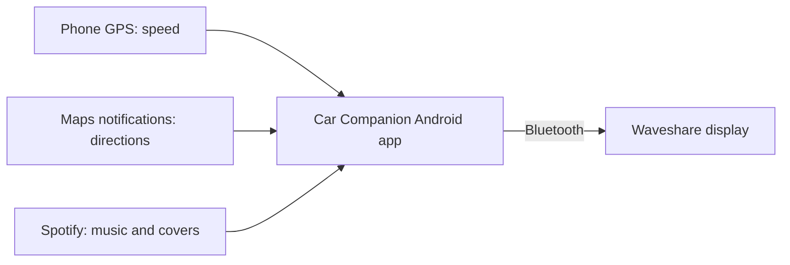

# Car Companion

A small touchscreen display for a 1999 Porsche Boxster 986. It shows speed, Google Maps directions and Spotify, using an Android phone and a Waveshare ESP32-C6-Touch-AMOLED-2.16.

The idea is to put the useful stuff near the rearview mirror, with a simple black screen that feels at home in the car.

<!-- Replace the placeholder above with a photo of the actual display. -->

## How we got here

We started with a screen and an idea: give an older Boxster a little more information without replacing its dashboard.

First, we needed a source for the driving data. The Waveshare board has no GPS receiver, so the phone supplies its speed. Directions were a separate problem: Google Maps doesn't give other apps a direct feed of its current route. Instead, we read the directions in its Android notifications and send them to the display over Bluetooth.

Once the screen, touch controls and Bluetooth worked, we added Spotify. That's where things got messy. Covers didn't always appear, songs took too long to update, and long titles stacked over other text. We fixed the image transfer, made better use of the limited memory and cleaned up the text.

Next came automatic reconnection when the display powers on, album covers on every page, and switching to Navigation when a route starts. Testing on the phone caught a Maps notification format we hadn't handled, so we fixed that too.

This is now running on the actual phone and display. Vehicle testing is still ahead.

## What it shows

- **Driving:** speed in mph, time, connection status and a small album cover with the current song.
- **Navigation:** the next turn, distance, road and arrival time when Maps makes them available, plus speed and the current song.
- **Music:** a large album cover, title, artist, progress and playback controls.

From Driving, swipe left for Music or right for Navigation. A new route opens Navigation automatically. You can still swipe to another page while navigating.

Audio stays on the phone and car stereo. No Raspberry Pi needed.

## Try it yourself

You'll need the **exact Waveshare ESP32-C6-Touch-AMOLED-2.16 board**, an Android phone and a USB data cable.

1. Install the display software using the [hardware guide](docs/hardware-setup.md). Back up its existing firmware first.
2. Build and install the phone app using the [Android guide](docs/android-setup.md).
3. Open Car Companion and choose **Connect a display**. Pair through the app.
4. Allow the requested permissions, including **Car Companion: Maps & media** notification access, then start the companion.
5. Try Spotify and a Maps route while parked, or use **Demo mode** for sample data.

Once set up, the app can keep the connection running in the background. After Android restarts the app in the background, you may need to open it to resume GPS speed.

## Wiring and installation photos

Photos of the wiring and fuse-box connection will go here as the installation comes together.

| Wiring | Fuse-box connection |
| --- | --- |
|  |  |
| Power wiring and cable routing. | The fuse tap and power connection. |

<!-- Replace these placeholders with actual installation photos and update the image paths. -->

## A few limits

Maps can change what its notifications contain. If an instruction is missing or out of date, the display leaves it unavailable. Speed comes separately from the phone's GPS.

Speed limits need a separate road-data service. None is included by default, so the limit shows `—` unless a valid source is configured. [More about speed limits](docs/speed-limits.md).

Artwork, reconnection and navigation switching work on the real devices. Road driving and Android Auto with the Alpine head unit still need testing. See the [recorded results](docs/validation.md).

## Inside the repo

The phone app is in `android/`, display software in `firmware/`, and setup guides in `docs/`.

For more detail: [testing](docs/testing.md), [troubleshooting](docs/troubleshooting.md), [Maps integration](docs/navigation-integration.md) and [Bluetooth protocol](protocol/specification.md).

An independent enthusiast project, [MIT licensed](LICENSE) and unaffiliated with Porsche. Built using [Waveshare's documentation and examples](docs/hardware-setup.md#verified-manufacturer-sources). See [third-party credits](THIRD_PARTY_NOTICES.md) for library and font licenses.
