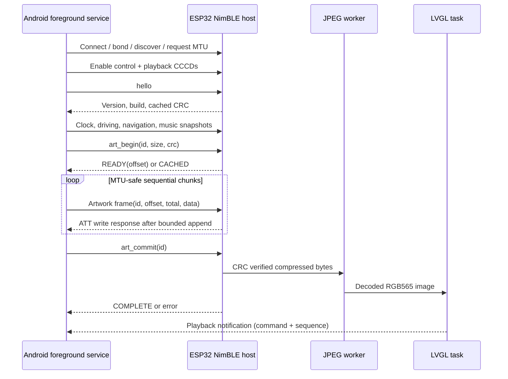

# BLE implementation guide

The authoritative byte layout, UUIDs, payloads, bounds and recovery behavior are in [protocol/specification.md](../protocol/specification.md). Machine-readable examples are in [golden-vectors.json](../protocol/message-definitions/golden-vectors.json). The independent Python conformance oracle is [reference.py](../protocol/reference.py).

Metadata and pictures have separate logical receivers. Artwork is never base64 or JSON. ATT write responses provide flow control; one write at a time avoids overflowing the C6 or Android GATT queue. Completion means that a valid JPEG has been decoded, not merely that the last packet arrived. A matching cached CRC skips retransmission on reconnect. An interrupted transfer is discarded on disconnect; Android sends a new transaction.

The peripheral advertises only a custom data service. It has no Bluetooth Classic, A2DP, HFP, AVRCP, Wi-Fi hotspot or audio-routing role. All playback commands go back to the phone's existing Spotify session.

Do not change characteristic UUIDs or the envelope in one endpoint alone. Update the protocol version, golden vectors, Kotlin tests and firmware tests together. Run `python3 -m unittest discover -s protocol -v` from the repository root for the independent reference tests. These tests do not replace over-the-air interoperability testing.

### Navigation step identity (build 3)

Navigation snapshots may include `step_id`, an unsigned 32-bit integer. Zero or omission means unavailable; otherwise it is the SDK's zero-based step number plus one. Firmware uses changes to distinguish consecutive same-road/same-maneuver instructions for local speech. Invalid values reject the snapshot. Older peers can omit/ignore the field; framing and protocol version remain 1.0. Local speech requires `source: "Google Navigation SDK"`, active fresh navigation, and a connected non-demo session.
