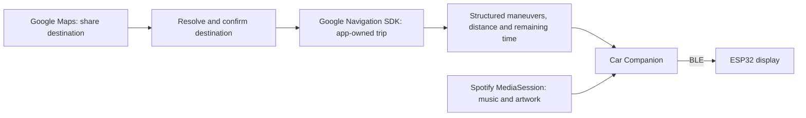

# Navigation: from notification parsing to the Google SDK

## Why we changed it

The first version listened to Google Maps' ongoing Android notification. It was a convenient way to keep using Maps normally and forward the text to a small display. It also let us prove the Bluetooth connection, automatic page switching, and navigation layout before building a navigation app.

In practice, the owner reported that directions kept glitching. The notification was a presentation surface, not a navigation-data contract. Our parser had to guess which public text fields contained the instruction, distance, road, and arrival time. One observed Maps version combined distance and instruction into a title such as `350 ft · Keep right to stay on Sample Rd`, left the normal text field empty, and put arrival time in the subtitle. That needed a parser fix. Icons alone could not provide a trustworthy maneuver.

There was also a mismatch between notification updates and our freshness rules. An unchanged notification could keep the route present while the app deliberately cleared instruction fields after 30 seconds. Notification removal/replacement needed a grace period; listener disconnects and missing route evidence could end navigation. These are concrete weaknesses in the old implementation, not a claim that we diagnosed every glitch on the road. Patching individual formats did not make notifications a stable turn-by-turn feed.

The display is now intended to replace the Android Auto screen for music and simple directions. That makes owning the navigation session in Car Companion a better fit than trying to observe another app's session.

## The new flow

1. In Google Maps, open a destination and choose **Share → Car Companion**.
2. The app resolves the link and shows the destination. If address lookup produces several matches, choose the correct one.
3. Tap **Start navigation**, grant precise location/Nearby devices permissions, and accept Google's SDK terms on first use.
4. Car Companion starts its foreground service and asks Navigation SDK 8.0.0 for a driving route from the phone's current location.
5. The SDK sends structured turn-by-turn updates to `NavigationFeedService`. `GoogleNavigationSession` publishes a `NavigationState`; the existing companion service sends it over BLE.
6. **Stop navigation**, arrival, or **Stop companion** clears the route. Starting demo mode stops the real trip.

The share transfers a destination, not Maps' active trip. The SDK can choose a different route. Multi-stop links are rejected rather than silently dropping stops. Only a single driving destination is supported.

## What is implemented

- Android `ACTION_SEND` handling for `text/plain` Maps shares.
- Bounded HTTPS short-link resolution, with an allowlist checked at every redirect. No API key is sent to shared URLs; page HTML is not scraped.
- Destination place IDs, explicit destination/query coordinates, single destination paths, and address lookup through Android's Geocoder. Map camera coordinates (`@lat,lng`) are never treated as a destination.
- A destination confirmation screen, including candidate selection for ambiguous addresses.
- SDK initialization and authorization errors surfaced to the user, with no automatic notification fallback.
- Structured maneuver mapping, imperial distance formatting, remaining trip duration, rerouting state, and stale-feed clearing after 30 seconds.
- Foreground navigation, arrival handling, trip replacement, and explicit stop. Late route-result callbacks are ignored after cancellation.
- Existing BLE protocol and page switching preserved. The firmware's navigation header now attributes active Google guidance to Google Maps.

The SDK guidance feed is documented to update about once per second. This removes reliance on Maps' notification wording or update schedule; it does not eliminate GPS, network, permission, or Android process-lifetime failures. Routes are not automatically restored after process death. Share the destination again to restart a trip.

## Spotify still uses notification access

Android grants access to other apps' active media sessions through an enabled notification listener. The original listener component name is retained so existing users keep their permission grant, but it no longer inspects notification contents, polls Maps, or publishes navigation. Its Settings label is now **Car Companion: Spotify media**. The old parser and its regression tests remain as historical, unused code.

## Setup, privacy, and limits

See [Android setup](android-setup.md) for the API key, billing, and Android package/signing restrictions. Credentials belong in ignored `android/local.properties` or a build environment variable, never in Git. An Android API key is embedded in the installed APK; package/certificate restrictions are important.

Short links are resolved with Google. Address lookup uses the phone's geocoding provider. The Navigation SDK receives the destination and location needed to navigate. The app keeps the active destination and feed in process memory and does not write route history or shared links to its diagnostic log.

Google's current [Navigation SDK policies](https://developers.google.com/maps/documentation/navigation/android-sdk/policies) state that the SDK is allowed only for commercial applications. This repository is a personal enthusiast project: eligibility for actual use must be resolved with Google; an API key or a successful build does not establish permission. Billing and SDK enablement also cannot be inferred from possession of a key.

Unsupported shortened-link redirects, country-specific Maps domains, unavailable geocoding, and ambiguous places can require sharing a pinned place or a supported full Maps URL. Location must be precise. Navigation can continue while the display reconnects, but phone lock, permission revocation, service restarts, real driving, voice/music interaction, and arrival all still need physical acceptance tests.

## Sources

- [Navigation SDK setup and requirements](https://developers.google.com/maps/documentation/navigation/android-sdk/setup-overview)
- [App-owned destination routing](https://developers.google.com/maps/documentation/navigation/android-sdk/route)
- [Structured turn-by-turn feed for external displays](https://developers.google.com/maps/documentation/navigation/android-sdk/tbt-feed)
- [Policies and attribution](https://developers.google.com/maps/documentation/navigation/android-sdk/policies)
- [Original notification-listener API](https://developer.android.com/reference/android/service/notification/NotificationListenerService)

Automated checks and physical validation are recorded separately in [validation.md](validation.md).
